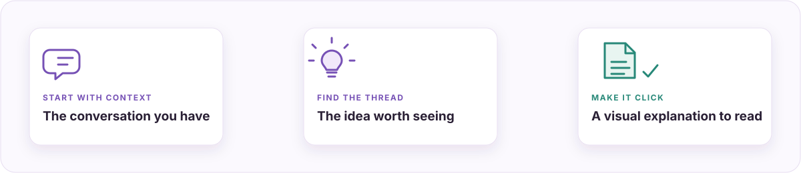

<div align="center">


# VibeView

### Make AI answers a pleasure to understand.

VibeView turns dense AI answers into visual explanations people can follow, remember, and share. An open Agent Skill for making plain text feel clear, human, and alive.

[**See what it makes ↓**](#see-vibeview-in-action) · [Try it in your Agent](#get-started) · [Explore similar skills](#how-vibeview-fits) · [简体中文](README.zh-CN.md)

[](https://agentskills.io/home) [](https://www.python.org/) [](LICENSE)

</div>

<a id="see-vibeview-in-action"></a>


<div align="center">

**One hard-to-follow answer, reshaped into a visual story.** The example shows why a timeout does not mean “nothing happened”—and how a clear diagram can make that distinction click.

[Open the full example](docs/index.html) · [Read the source prompt](examples/reading-map.input.md)

</div>

## From AI wall of text to an explanation that clicks

A useful AI answer can still feel like work. The main idea hides in a wall of text; cause and effect blur together; key trade-offs appear three screens too late. VibeView gives the answer a visual shape, so readers can see how the pieces fit before they get lost in the details.

**VibeView helps an Agent turn that explanation into something people can see, follow, and enjoy reading.** It starts with the conversation you already have, then composes around the meaning: a mechanism, a comparison, a visual analogy, a reading path—or whatever makes this particular subject click. The page brings the picture and the full explanation together, so visual clarity does not come at the cost of important detail.

### From conversation to clarity



Start with the context you already have. Make the relationship that matters visible. Keep the full explanation close enough to follow.

**Try saying:**

```text
vv explain the analysis so I can see the main idea, evidence, and trade-offs
```

`vv` is a natural-language shortcut for a Skill-compatible Agent—not a shell command. VibeView is designed for complex answers; a short answer should stay short.

## How VibeView fits

VibeView is part of a fast-moving field of Agent Skills that turn information into visual output. The strongest projects overlap in real ways; each is tuned for a different job. This guide compares their stated workflows, not benchmark scores.

| Project | Best when you want to… | VibeView’s angle |
| --- | --- | --- |
| **[visual-explainer](https://github.com/nicobailon/visual-explainer)** | Create rich pages or slide decks for engineering work such as diagrams, diff reviews, plan audits, data tables, and project recaps. | A strong choice for engineering-specific workflows and interactive explainers. VibeView focuses on the reading experience of an answer already developed in the conversation, for technical or everyday topics. |
| **[visualise](https://github.com/bentossell/visualise)** | Render inline interactive visuals—SVG diagrams, HTML widgets, charts, and explainers—inside an Agent conversation. | A strong choice when the host renders interactive visuals inline. VibeView composes a complete visual reading experience around the answer. |
| **[visualize](https://github.com/careerhackeralex/visualize)** | Turn a prompt into a standalone HTML visualization such as a slide deck, dashboard, infographic, or flowchart. | A strong choice for broad, artifact-first HTML creation. VibeView starts with an explanation and asks how to make it easier to understand. |
| **[visualize by display.dev](https://github.com/display-dev/visualize)** | Create on-brand artifacts with a persistent brand profile and commands for exploring, reviewing, and polishing. | A strong choice when brand consistency and an artifact-review workflow lead the task. VibeView leads with the content’s visual explanation and reading rhythm. |

Among the adjacent projects reviewed, **[visual-explainer](https://github.com/nicobailon/visual-explainer)** has the largest GitHub audience: about **10.6k stars** when checked on October 21, 2026. It has earned that audience with a broad, feature-rich toolkit. These projects prove there is demand for richer Agent output. VibeView’s opportunity is to own one promise readers can repeat: **make the answer you already have feel effortless to understand.** Star counts change over time.

**The VibeView sweet spot:** the answer is already there, but plain text makes the idea harder to see than it should be.

<details>
<summary><strong>Other tools for nearby jobs</strong></summary>

- [Claude Artifacts](https://support.anthropic.com/en/articles/9487310-what-are-artifacts-and-how-do-i-use-them) for creating and iterating on interactive artifacts inside Claude.
- [Napkin AI](https://www.napkin.ai/) for turning text into visual assets such as diagrams and infographics.
- [Gamma](https://gamma.app/) for designed presentations, documents, webpages, and social posts.
- [Mermaid](https://mermaid.js.org/intro/) for diagrams maintained as text in documentation and code.

</details>

## Get started

VibeView follows the [open Agent Skills format](https://agentskills.io/home). Use it in any compatible Agent harness that loads standard Skills and can run local Python scripts; the install path depends on your harness.

```bash
git clone https://github.com/tahoeliu/vibeview.git
```

Place the `vibeview` folder in your harness’s Skills directory, then reload Skills if needed. Keep the complete folder: `SKILL.md`, `scripts/`, `assets/`, and `references/`.

In a conversation, try:

```text
vv turn the explanation above into a visual guide. Keep the evidence, edge cases, and sources visible.
```

The Agent creates the page from the current context. VibeView contributes the visual storytelling guidance and local builder; the Agent remains responsible for the new explanation and visual composition.

### Preview the included example without an Agent

The repository includes a ready-made English example. Build it locally with Python 3:

```bash
python3 -B scripts/compose.py examples/reading-map.fragment.html preview.html \
  --title "After a timeout, don't do the same thing twice" --theme violet
```

Open `preview.html` in a browser. The builder uses only Python’s standard library and refuses to overwrite an existing output. It assembles an authored HTML fragment; it does not convert Markdown into diagrams.

## A better way to read what AI already knows

- **The right picture for this idea.** The Agent chooses a visual structure for the explanation instead of squeezing every topic into the same template.
- **The detail stays with the story.** Readers get the main idea at a glance and the evidence, caveats, tables, and sources when they need them.
- **Start where the thinking happened.** VibeView works from the current conversation and completed Agent work, without asking you to create a separate report first.
- **Designed to feel good to read.** Visual hierarchy, a clear focal point, and intentional pacing turn “I know the answer” into “I get it.”
- **Simple to keep and share.** The current composer produces a standalone page with no JavaScript, remote fonts, or server in its default shell.

## Where it fits—and where it doesn’t

VibeView is built for mechanisms, comparisons, explainers, and analysis that is ready to present. It is not a live dashboard, automatic fact-checker, or substitute for research. Check facts, sources, assumptions, and conclusions before sharing. The local builder checks authored markup; it is not a full sanitizer for untrusted HTML.

<details>
<summary><strong>Technical details, boundaries, and release notes</strong></summary>

- Current release: **1.5.2**. The repository includes a standalone HTML composer, reusable CSS primitives, an optional JSON renderer, and a visual reading example.
- Python 3 is required for local scripts. The scripts use the standard library; no package installation is needed.
- The included example completed 100 isolated regression cases on Python 3.13.12 / macOS. This does not establish cross-platform behavior or make arbitrary HTML safe.
- The Agent host controls model use and network access. A local build does not mean the full workflow is offline.
- The example adds a narrow-screen layout, but VibeView is desktop-first and has not been validated across every mobile device.
- Generated pages are local files. Publishing or hosting them is a separate step; check for sensitive content before sharing.

</details>

## Help it reach more people

If VibeView makes a difficult answer easier to follow, **[star the repository](https://github.com/tahoeliu/vibeview)** or share a sanitized example. Contributions that improve visual examples, documentation, or reproducible bug reports are welcome.

Found a problem? [Open an issue](https://github.com/tahoeliu/vibeview/issues) with the version, Python/OS version, command, error, and a minimal example that is safe to share. Never post tokens, keys, or confidential material.

## License

MIT © 2026 tahoeliu. See [LICENSE](LICENSE).
