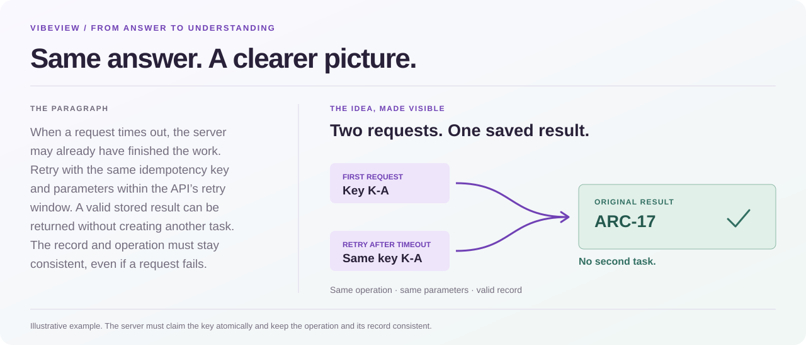
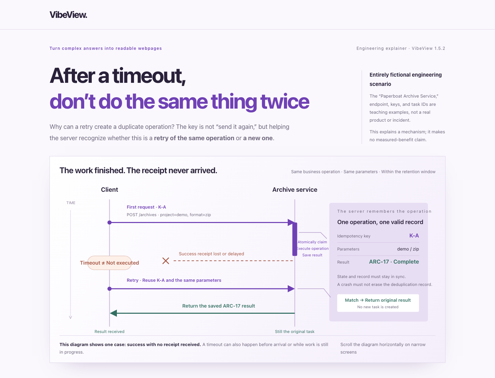
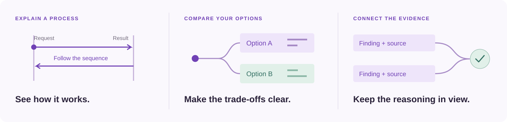

<div align="center">


# VibeView

### 让 AI 的答案更易理解，也更愿意读下去。

一个开源 Agent Skill，把当前对话中的长篇答案组织成清晰的视觉讲解。

[English](README.md) · [简体中文](README.zh-CN.md)

</div>



AI 给出了答案，理解它仍然需要花力气。VibeView 使用当前对话和已经完成的分析，把机制、差异、因果与依据画清楚，同时保留需要仔细阅读的细节。

```text
vv 把上面的解释变得更好懂
```

## 看实际效果

**为什么超时后重试，可能创建重复任务？** 这个示例先画出请求时序，再解释处理规则及其边界。

[](docs/preview.png)

[示例页面源码](docs/index.html) · [下载页面](https://raw.githubusercontent.com/tahoeliu/vibeview/main/docs/index.html) · [原始问题与答案](examples/reading-map.input.md)

截图来自本仓库组装器生成的页面。工程场景为虚构示例。将页面保存为 `.html` 后用浏览器打开，也可以运行下方命令在本机构建。

## 你想把什么讲清楚？



```text
vv 解释这个机制，包括失败路径
vv 对比这些方案，把收益、成本和适用条件画清楚
vv 把刚才的分析组织成视觉讲解，保留依据和边界
```

- **围绕内容设计。** Agent 为主题选择图形和构图，不强迫每个答案套用同一个模板。
- **细节与图形一起读。** 说明、表格与来源在同一页展开，正常滚动即可阅读。
- **接着当前工作继续。** 使用对话里已经得到的结果，不默认先写第二份报告或重复研究。

## 开始使用

VibeView 遵循[开放的 Agent Skills 格式](https://agentskills.io/home)。支持标准本地 Skills、文件创建与 Python 3 脚本执行的 harness 均可使用。脚本仅依赖 Python 标准库。

```bash
git clone https://github.com/tahoeliu/vibeview.git
```

将完整的 `vibeview` 文件夹放入 harness 的技能目录，按照宿主说明重新加载。保留 `SKILL.md`、`scripts/`、`assets/` 与 `references/`。

在当前对话中输入：

```text
vv 用视觉讲解整理上面的分析，保留关键结论、依据和取舍
```

`vv` 是在 Agent 对话中使用的提示约定。Agent 创作正文与图形，再调用本地构建工具生成页面。简短答案无需生成网页。

<details>
<summary><strong>在本机构建示例</strong></summary>

从仓库目录运行：

```bash
python3 -B scripts/compose.py examples/reading-map.fragment.html preview.html \
  --title "Retry the request. Reuse the result." --theme violet
```

使用浏览器打开 `preview.html`。每次构建请选新文件名，组装器拒绝覆盖已有文件。Python 组装已创作的 HTML 片段；新内容与图形由 Agent 负责。

</details>

## 同类视觉 Skills

这些项目的能力存在交集，主要侧重不同的使用流程。

| Skill | 主要侧重 |
| --- | --- |
| **VibeView** | 把当前对话中已有的解释组织成好读的视觉讲解，自主构图，并在同一页保留必要细节。 |
| [visual-explainer](https://github.com/nicobailon/visual-explainer) | 视觉页面和幻灯片，提供架构、代码差异审查、计划核对、数据表和项目复盘等工作流。 |
| [visualise](https://github.com/bentossell/visualise) | 在兼容的对话渲染器中内联展示交互 SVG、组件与图表。 |
| [visualize](https://github.com/careerhackeralex/visualize) | 从提示生成多种 HTML 可视化，包括看板、信息图、流程图与幻灯片。 |
| [visualize by display.dev](https://github.com/display-dev/visualize) | 保持品牌一致性的 HTML 作品，以及探索、评审和打磨设计的工具。 |

VibeView 从这个需求出发：**“答案已经有了，帮我看懂它们之间的关系。”**

## 实现与边界

默认输出为独立页面，无需 JavaScript、远程字体或服务器；托管和发布另行进行。桌面阅读优先，示例补充了窄屏布局，但不承诺全面移动适配。

Agent 创作页面，效果与准确性取决于模型、材料和提示。分享前核对重要结论。组装器只对新创作的可信片段做静态检查，不能安全净化任意外部 HTML。模型使用和联网行为由宿主控制。

版本 1.5.2。该版本记录的 100 项隔离回归使用 Python 3.13.12 / macOS，不代表所有平台均已验证。[JSON 组件渲染路径](references/template.md)可用于规则化结构，默认仍推荐自主创作。

欢迎分享可公开的视觉讲解、贡献示例，或 [Star 项目](https://github.com/tahoeliu/vibeview)。问题请通过 [Issues](https://github.com/tahoeliu/vibeview/issues) 提供 Python 与系统版本、命令、错误和不含隐私信息的最小示例。

[MIT](LICENSE) © 2026 tahoeliu
